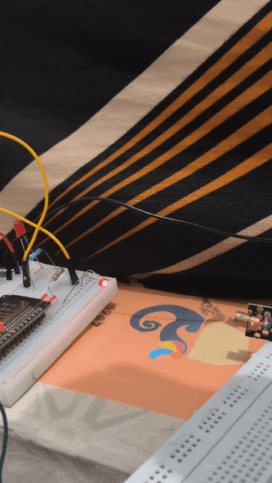
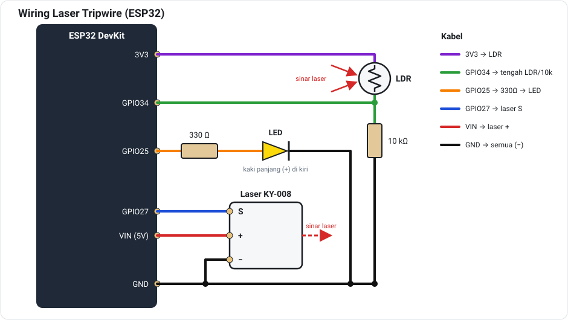

<a name="atas"></a>

# Laser Tripwire ESP32

Jebakan laser berbasis ESP32: sinar laser KY-008 ditembakkan lurus ke sensor cahaya LDR. Selama sinar mengenai LDR, semuanya aman. Begitu ada yang lewat dan memutus sinar, lampu LED langsung berkedip.



---

<details>
<summary> KLIK UNTUK DAFTAR ISI </summary>

* [Fitur](#fitur)
* [Perangkat Keras](#perangkat-keras)
* [Wiring](#wiring)
* [Cara Kerja](#cara-kerja)
* [Perangkat Lunak](#perangkat-lunak)
* [Cara Pakai](#cara-pakai)
* [Konfigurasi](#konfigurasi)
* [Pemecahan Masalah](#pemecahan-masalah)
* [Struktur Proyek](#struktur-proyek)
* [Lisensi](#lisensi)

</details>

---

<br>

## <a name="fitur"></a><sub></sub> Fitur

- Mendeteksi orang atau benda yang memutus sinar laser
- Kalibrasi otomatis saat dinyalakan, jadi tidak perlu mengatur nilai sensor secara manual
- Lampu LED berkedip dan tetap berkedip beberapa detik setelah sinar terputus, sehingga objek yang lewat cepat tetap terdeteksi
- Nilai sensor ditampilkan di Serial Monitor untuk membantu penyetelan
- Tanpa library tambahan

[[Ke atas]](#atas)

---

<br>

## <a name="perangkat-keras"></a>Perangkat Keras

| Komponen | Keterangan |
|---|---|
| ESP32 DevKit | Board ESP32 apa pun |
| Modul laser KY-008 | Sumber sinar |
| LDR (photoresistor) 2 kaki | Sensor cahaya, tanpa polaritas |
| Resistor 10 kΩ | Pembagi tegangan untuk LDR |
| Resistor 330 Ω | Pembatas arus LED |
| LED | Lampu indikator |
| Breadboard + kabel jumper | |
| Kabel USB | Daya dan upload kode |

[[Ke atas]](#atas)

---

<br>

## <a name="wiring"></a>Wiring



| Komponen | Pin komponen | Pin ESP32 | Warna kabel |
|---|---|---|---|
| LDR | Kaki 1 | 3V3 | Ungu |
| LDR | Kaki 2 (titik tengah dengan resistor 10 kΩ) | GPIO34 | Hijau |
| Resistor 10 kΩ | Ujung lain | GND | Hitam |
| Laser KY-008 | S | GPIO27 | Biru |
| Laser KY-008 | Tengah (+) | VIN (5V) | Merah |
| Laser KY-008 | − | GND | Hitam |
| Resistor 330 Ω | Satu ujung | GPIO25 | Oranye |
| LED | Kaki panjang (+) ke resistor 330 Ω, kaki pendek (−) ke GND | - | Hitam |

> [!NOTE]
> LDR dan resistor 10 kΩ membentuk pembagi tegangan. Titik sambungan keduanya dibaca oleh GPIO34. GPIO34 adalah pin ADC1 (input-only).

> [!WARNING]
> Jangan arahkan laser ke mata orang atau hewan, dan hati-hati dengan permukaan yang memantul seperti cermin atau kaca.

[[Ke atas]](#atas)

---

<br>

## <a name="cara-kerja"></a>Cara Kerja

1. Saat dinyalakan, laser menyala terus. ESP32 menunggu 1 detik supaya sensor stabil, lalu merata-ratakan 64 pembacaan LDR sebagai **baseline** (kondisi normal, saat sinar mengenai LDR).
2. Di tiap loop, ESP32 membaca rata-rata 8 pembacaan LDR. Kalau selisihnya dari baseline lebih besar dari `THRESHOLD`, sinar dianggap **terhalang**.
3. Setiap kali terhalang, waktunya dicatat. Selama `HOLD_MS` setelah halangan terakhir, alarm aktif dan LED berkedip setiap `BLINK_MS`. Setelah itu LED mati dan sistem kembali siaga.

[[Ke atas]](#atas)

---

<br>

## <a name="perangkat-lunak"></a>Perangkat Lunak

| Kebutuhan | Keterangan |
|---|---|
| [Arduino IDE](https://www.arduino.cc/en/software) | Untuk menulis dan meng-upload kode |
| Paket board [esp32 by Espressif Systems](https://github.com/espressif/arduino-esp32) | Install lewat `Tools → Board → Boards Manager`, cari "esp32" |

Tidak ada library tambahan.

### Upload

1. Clone repositori ini.
2. Buka `laser_tripwire_esp32/laser_tripwire_esp32.ino` di Arduino IDE.
3. Pilih board ESP32 dan port yang sesuai.
4. Klik **Upload**.

[[Ke atas]](#atas)

---

<br>

## <a name="cara-pakai"></a>Cara Pakai

1. Pasang laser dan LDR pada permukaan yang stabil, berhadapan dan lurus.
2. **Pastikan sinar laser tepat mengenai LDR sebelum ESP32 dinyalakan atau di-reset**, karena kondisi normal diukur saat itu.
3. Nyalakan ESP32 lewat USB.
4. Lewati atau halangi sinar laser. LED akan berkedip.
5. Opsional: buka Serial Monitor (115200 baud) untuk melihat nilai sensor dan status `aman` atau `TERHALANG`.

> [!NOTE]
> Tekan tombol reset (EN) di ESP32 kalau posisi laser atau LDR berubah, supaya baseline diukur ulang.

[[Ke atas]](#atas)

---

<br>

## <a name="konfigurasi"></a><sub></sub> Konfigurasi

Ubah konstanta berikut di bagian atas sketch:

| Konstanta | Default | Fungsi |
|---|---|---|
| `THRESHOLD` | `500` | Perubahan pembacaan (skala 0-4095) yang dianggap sinar terhalang |
| `HOLD_MS` | `3000` | Lama LED tetap berkedip setelah halangan terakhir (ms) |
| `BLINK_MS` | `100` | Kecepatan kedip LED (ms nyala dan ms mati) |
| `DEBUG_SERIAL` | `true` | Tampilkan nilai sensor di Serial Monitor |

[[Ke atas]](#atas)

---

<br>

## <a name="pemecahan-masalah"></a><sub></sub> Pemecahan Masalah

**Muncul peringatan "baseline ekstrem" di Serial Monitor**
- Sinar laser belum mengenai LDR saat dinyalakan, atau wiring LDR ke GPIO34 salah
- Kalau pembacaan saat sinar mengenai LDR terus mentok di sekitar 4095, coba ganti resistor pembagi 10 kΩ dengan nilai yang lebih kecil (misalnya 1 kΩ sampai 4,7 kΩ)

**Orang lewat tapi tidak terdeteksi**
- Turunkan `THRESHOLD`
- Lihat nilai sensor di Serial Monitor saat sinar mengenai LDR dan saat terhalang. Atur `THRESHOLD` kira-kira setengah dari selisihnya
- Pastikan sinar benar-benar mengenai LDR

**Sering salah deteksi**
- Naikkan `THRESHOLD`
- Hindari cahaya matahari langsung, dan pastikan laser dan LDR terpasang kokoh

**LED tidak berkedip**
- Cek polaritas LED (kaki panjang ke resistor 330 Ω) dan sambungan ke GPIO25

**Laser tidak menyala**
- Cek S ke GPIO27, tengah ke VIN, dan − ke GND

[[Ke atas]](#atas)

---

<br>

## <a name="struktur-proyek"></a>Struktur Proyek

```
.
├── laser_tripwire_esp32/
│   └── laser_tripwire_esp32.ino
├── docs/
│   ├── demo.gif
│   └── wiring-diagram.svg
└── README.md
```

[[Ke atas]](#atas)

---

<br>

## <a name="lisensi"></a>Lisensi

Dirilis di bawah lisensi MIT. Lihat berkas [LICENSE](LICENSE).

---
